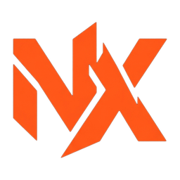

  

<h1 align="center">NXYVEN</h1>
<h3 align="center">Editor de Vídeo Profissional, Moderno e 100% Open Source.</h3>

  
  
  

## Sobre o NXYVEN

O **NXYVEN** é um editor de vídeo comercial e criativo desktop de alta performance, construído com motor nativo em Rust e renderizador acelerado por GPU (WGSL/WGPU). Desenvolvido para oferecer máxima fluidez e liberdade criativa, ele executa inteligência artificial local para legendas automáticas, síntese e clonagem de voz, e recorte inteligente de silhueta.

O NXYVEN possui identidade de execução e configuração totalmente própria e isolada (`app.nxyven.editor`), com suporte a instalação independente e sem dependência de serviços externos.

### Principais Funcionalidades

- ⚡ **Zero Marcas d'Água e Sem Conta:** Totalmente gratuito, sem paywalls nem assinaturas.
- 🔒 **100% Local e Privado:** Nenhum vídeo ou áudio é enviado para servidores na nuvem. Os modelos de IA rodam offline direto no hardware do seu PC.
- 🎨 **Estética Dark Radiant:** Interface elegante em tons neutros profundos (`#0D0D12`) com acentuação Radiant Orange (`#FF6A24`).
- 💬 **Legendas Automáticas com Whisper:** Reconhecimento de fala local e estilização instantânea na timeline.
- 🗣️ **Text-to-Speech & Voice Cloning:** Geração de locuções a partir de amostras de áudio locais.
- 🎞️ **Animação por Keyframes:** Controle milimétrico de posição, rotação, escala, opacidade e curvas Bezier.
- ✨ **Biblioteca de Efeitos:** Mais de 120 shaders e transições renderizados em tempo real pela GPU.
- 📦 **Instalador Autônomo e Leve:** Setup moderno com design cardSlint, criação automática de atalhos e integração nativa ao Windows.

---

## Download e Instalação

Baixe o instalador executável oficial na página de **[Releases](https://github.com/zxrafa/Nxyven/releases)**:
- **`NXYVEN-1.0.0-Setup.exe`** (Instalador autônomo para Windows 10 e Windows 11 x64).

Execute o instalador, selecione o diretório de sua preferência e crie vídeos com máxima performance.

---

## Licença

Distribuído sob licença livre [AGPL-3.0-or-later](LICENSE).
